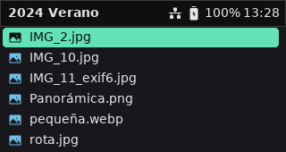
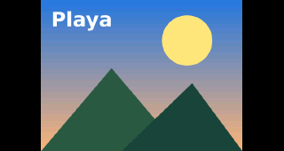

# ZeroGallery

Galería de fotos y vídeos para el [M5Stack Cardputer Zero](https://docs.m5stack.com/): se elige
una carpeta y se pasan sus fotos y vídeos a pantalla completa con las flechas del teclado.

<p>
  
  
</p>

Está hecha sobre la [plantilla oficial](https://github.com/CardputerZero/Template) (LVGL 9.5 +
CMake), así que se ve y se maneja como el resto de apps del aparato: barra de título con hora,
red y batería, tema claro u oscuro, ayuda con `Fn`+`H` y captura con `Fn`+`J`.

## Qué hace

- **Empieza en la carpeta personal** del usuario y deja entrar en cualquier subcarpeta (y subir
  hasta `/`, para llegar a una tarjeta o un USB montados). Carpetas primero y, dentro de cada
  grupo, en orden natural (`IMG_2` antes que `IMG_10`). Los ficheros ocultos no salen.
- **Fotos**: los JPEG se abren con libjpeg, ya reducidos al decodificar (una foto de 12 Mpx no
  ocupa 48 MB en memoria) y enderezados según su orientación EXIF. El resto de formatos los abre
  el `ffmpeg` del sistema: PNG, GIF, BMP, WebP, HEIC/HEIF, AVIF, JPEG XL, JPEG 2000, TIFF, TGA,
  ICO, SVG, QOI, PNM, EXR, HDR…
- **GIF y APNG animados** se reproducen en bucle.
- **Vídeos** con `ffmpeg`: MP4, MOV, MKV, WebM, AVI, MPEG, TS/MTS, WMV, FLV, OGV, 3GP… con
  cualquier códec que traiga el ffmpeg de Debian (H.264, HEVC, VP9, AV1, MPEG-2/4, Theora…).
  Se ven a 15 fotogramas por segundo, ajustados a la pantalla de 320×170.
- **Gira con el aparato**: en el visor, al poner el Cardputer de lado o boca abajo la foto o
  el vídeo se dan la vuelta para seguir viéndose derechos (lo dice el acelerómetro), y de lado
  se encajan en 170×320, que es como mejor se ven las fotos y los vídeos verticales. Tumbado
  en la mesa se queda como estaba. La lista de carpetas no gira.
- **Sonido** por PipeWire (el servidor de sonido del aparato): suena por donde esté saliendo
  el sonido del sistema —altavoz, auriculares o Bluetooth— y con su volumen. Si un vídeo no
  tiene sonido o no hay salida, se reproduce sólo la imagen.

## Teclas

Las flechas del Cardputer Zero están en `F`, `Z`, `X` y `C`: valen **con o sin `Fn`**.

| Tecla | En la lista | En el visor |
|---|---|---|
| `F` / `X` (↑ ↓) | Subir y bajar (dejándola pulsada, corre) | Anterior / siguiente |
| `Z` / `C` (← →) | Carpeta de arriba / abrir | Anterior / siguiente |
| `Enter` o espacio | Abrir carpeta, foto o vídeo | Pausar o reanudar el vídeo; repetirlo si acabó |
| Girar el aparato | — | Gira la foto o el vídeo |
| `Esc` | Carpeta de arriba | Volver a la lista |
| `Esc` **mantenido** | Salir de la app | Salir de la app |
| `T` | Tema claro / oscuro (se recuerda) | Lo mismo |
| `Fn`+`H` | Ayuda | Ayuda |
| `Fn`+`J` | Captura en `~/Pictures/Screenshots` | Lo mismo |

En la carpeta inicial un `Esc` corto no sale: recuerda que hay que mantenerlo.

## Instalar

Hace falta el `.deb` (ver más abajo cómo se compila). En el aparato:

```sh
scp dist/ZeroGallery_*_arm64.deb pi@<ip-del-cardputer>:
ssh pi@<ip-del-cardputer> 'sudo apt install ./ZeroGallery_*_arm64.deb'
```

`apt` instala también `ffmpeg` si falta. La app aparece en el lanzador como **Gallery**.

## Compilar

Con Docker no hace falta nada más: `Tools/compilar.sh` monta el entorno (Debian 13 con CMake,
SDL2 y el compilador cruzado) la primera vez. Sin Docker, el mismo script usa las herramientas
de la máquina si están instaladas (los paquetes de `Tools/Dockerfile`).

```sh
Tools/compilar.sh pruebas     # simulador de escritorio + pruebas de la lógica
Tools/compilar.sh deb         # dist/ZeroGallery_<versión>_rev1_arm64.deb
Tools/compilar.sh simulador   # abre el simulador con la carpeta personal de este PC
```

Sin Docker, con las dependencias instaladas (ver `Tools/Dockerfile`), son los *presets* de la
plantilla: `cmake --preset linux-x86-64` para el simulador y
`cmake --workflow --preset cp0-cross-package` para el `.deb`. La primera compilación descarga
LVGL y, para el aparato, el *sysroot* de M5Stack a `.cache/`.

## Cómo está hecho

```
src/model/gallery.*          lógica sin LVGL: listar, ordenar, navegar, encajar, EXIF, teclas
src/viewmodel/               qué hace cada tecla en cada pantalla; avisa a las vistas
src/platform/media_player.*  hilo que decodifica (libjpeg) y maneja ffmpeg
src/platform/linux_input.*   teclado (evdev) y repetición de flechas
src/view/screens/            lista de carpeta (browser) y visor a pantalla completa (viewer)
src/app/                     arranque, ESC corto/largo, simulador de escritorio
tests/gallery_test.cpp       pruebas de src/model
```

- Cargar y reproducir va en un hilo aparte: en la CM0 abrir una foto grande tarda décimas de
  segundo y en el hilo de la interfaz dejaría el teclado sin responder. Pedir otra foto
  abandona la anterior sin esperar.
- `ffmpeg` corre como proceso aparte y entrega fotogramas RGB565 de 320×170 por una tubería.
  Así la app no enlaza las librerías de códecs y un fichero roto no la tira. Para el vídeo
  saca la imagen y el sonido del mismo proceso, que es lo que los mantiene a la par.
- Pausar un vídeo es parar ese proceso y, al reanudar, lanzarlo otra vez desde donde iba.
- La lista sólo crea las seis filas que caben en pantalla, tenga la carpeta las fotos que tenga.

## Estado

**0.1.0 (16-nov-2026)** — primera versión. Probada en el simulador de escritorio: carpetas
(también largas), fotos con giro EXIF, GIF animado, vídeo con pausa, reanudación y repetición,
y salida con `Esc`. Las órdenes de `ffmpeg` que usa la app se han comprobado con 23 formatos de
imagen y 11 combinaciones de contenedor y códec de vídeo.

**0.2.0 (16-nov-2026)** — fotos y vídeos giran con el aparato. Probado en el simulador con un
acelerómetro de mentira en las cuatro posiciones (foto, vídeo en marcha y en pausa) y
comprobado en el aparato.

Quedan por confirmar en el aparato el sonido (en el simulador no había salida de audio) y la
fluidez con vídeos de alta resolución, que la CM0 decodifica por software.

## Licencia

MIT, como la plantilla de M5Stack de la que parte (ver `LICENSE`). Los iconos son de
[Phosphor Icons](https://phosphoricons.com/) (MIT; ver `assets/fonts/LICENSE.txt`).
